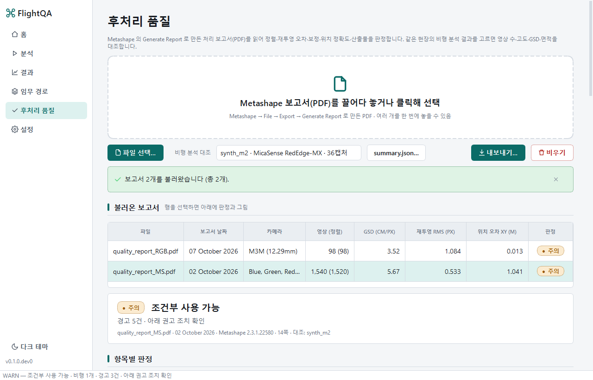
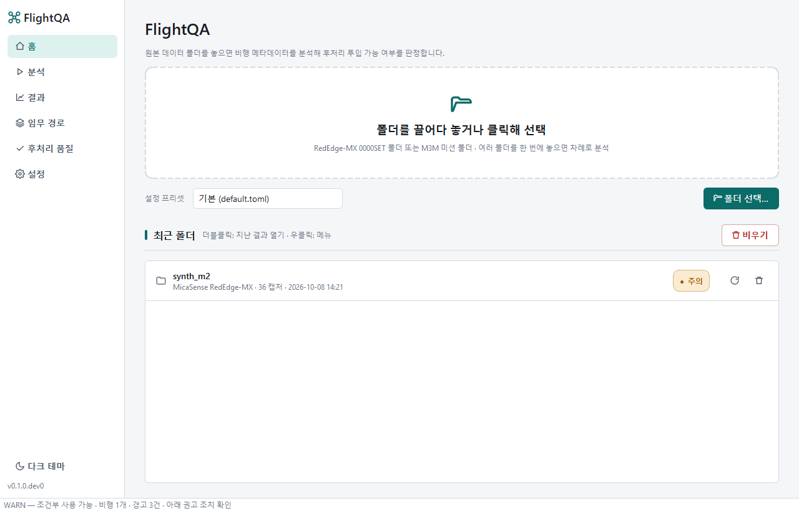
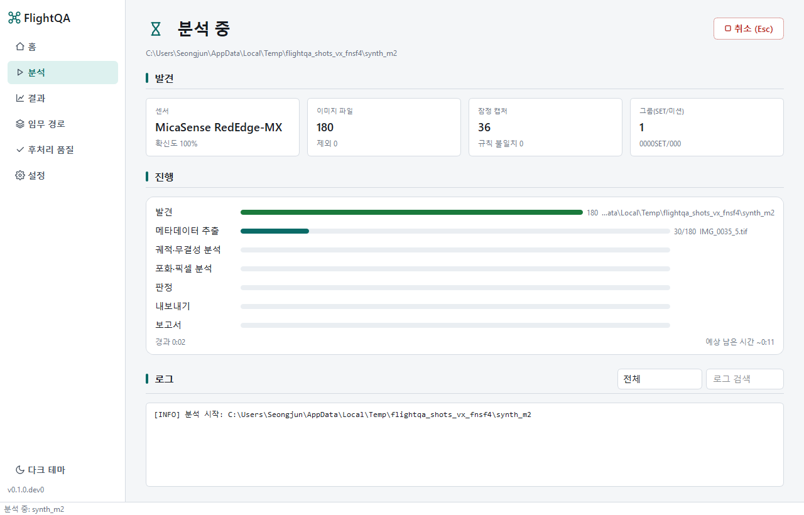
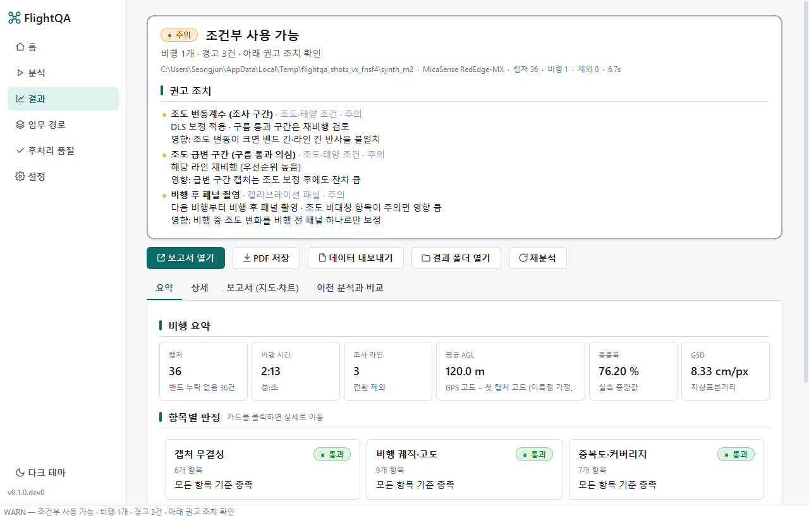
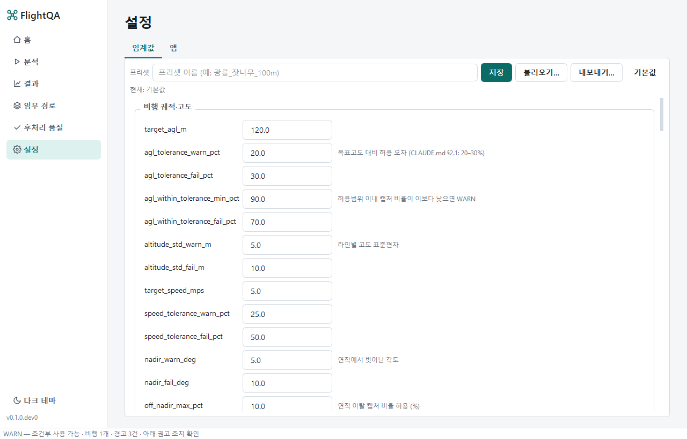
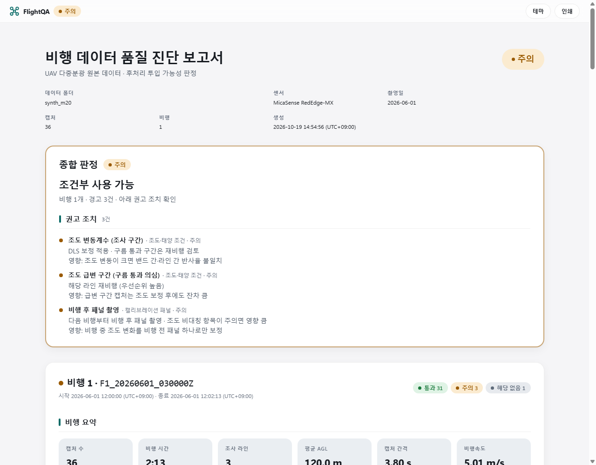

# FlightQA

UAV 다중분광 비행 데이터 품질 진단 도구.
현장조사 후 원본 폴더 하나를 지정하면 비행 메타데이터를 분석해 후처리(Metashape / DJI Terra) 투입 가능
여부를 판정하고 근거를 담은 보고서를 만든다.

지원 센서 (Phase 1)
- MicaSense RedEdge-MX (DJI M350 RTK + Quick Mount) — RedEdge-M 과 태그 구조 동일
- DJI Mavic 3 Multispectral (M3M)

> 현재 상태: **M5 (배포)** 완료 — Windows onedir 빌드(`FlightQA.exe`, `flightqa-cli.exe`, exiftool 번들, zip 약 340 MB). 데스크톱 앱(홈·분석·결과·설정, 드래그앤드롭, 취소, 프리셋, 최근 목록, 이전 분석 비교, 라이트/다크), HTML 단일 파일 보고서(오프라인·인쇄 CSS), PDF(QtWebEngine), 한국어/영어. 폴더 탐색 → exiftool 병렬 추출(캐시) → 캡처 무결성·궤적·고도·속도·RTK → 실측 중복도·커버리지 → 포화·노출(픽셀 병렬) → 조도·태양(pvlib) → 캘리브레이션 패널 → 종합 판정 → JSON/CSV/GeoJSON 내보내기.

<details>
<summary><b>English overview</b></summary>

FlightQA checks raw UAV multispectral flight folders before you spend hours in Metashape or DJI Terra. Point it at one folder and it reads every capture's EXIF/XMP with a single batched exiftool process, then reports whether the data is fit for photogrammetric processing and why.

- **Sensors**: MicaSense RedEdge-MX (DJI M350 RTK, Quick Mount) and DJI Mavic 3 Multispectral.
- **Checks**: capture integrity, trajectory and altitude (optional DEM-based AGL), measured forward/side overlap and coverage, exposure and pixel-level saturation, irradiance stability and sun elevation (pvlib), calibration panel captures, and an overall verdict with recommended actions.
- **Outputs**: a self-contained offline HTML report, PDF, and JSON/CSV/GeoJSON exports for QGIS.
- **Interfaces**: a PySide6 desktop app and an equivalent CLI (`flightqa run <folder>`). The app also reads mission KMZ files and Metashape processing reports.
- **Development**: `uv sync`, then `uv run python scripts/check.py` (ruff, mypy --strict, pytest). The UI is in Korean; reports are available in Korean and English.

</details>

## 설치 (사용자)

**Windows (Python 불필요)** — 빌드한 PC 에서는 앱 폴더(저장소 `dev\` 의 상위 폴더) 의 `FlightQA.exe`, 또는 바탕화면·시작 메뉴의 **FlightQA** 바로가기를 더블클릭한다. 같은 폴더의 `dev\` 는 개발 저장소이며 실행에는 쓰이지 않는다. 다른 PC 에는 `FlightQA-<버전>-win64.zip` 을 풀고 `FlightQA.exe` 를 더블클릭한다. exiftool 이 함께 들어 있어 별도 설치가 없다.
설치 프로그램(`FlightQA-<버전>-setup.exe`)이 있으면 그것으로 설치해도 된다 (관리자 권한 불필요, 사용자 폴더에 설치).

배포 폴더에는 `FlightQA.exe`, `시작하기.txt`, `docs\`, `tools\` 만 보인다. 프로그램 구성 요소(`_internal\`, `flightqa-cli.exe`)는 숨김 속성이라 탐색기 기본 설정에서는 보이지 않으며, 옮기거나 지우면 안 된다. 폴더 전체를 통째로 복사해야 다른 PC 에서 실행된다.

- 명령줄 도구는 `tools\flightqa-cli.cmd` (`tools\flightqa-cli.cmd run <폴더> --mission 임무.kmz`). 숨겨진 `flightqa-cli.exe` 를 대신 불러 준다.
- 기관 PC 에서 서명 없는 exe 가 차단되면 아래 개발 환경 방법(소스에서 `uv run flightqa-gui`)으로 실행한다.
- 처음 실행 시 Windows SmartScreen 경고가 뜨면 "추가 정보 → 실행".

**macOS** — `packaging/build_macos.sh` 로 만든 `FlightQA` 번들. 코드서명이 없으므로 처음에는 Finder 에서 우클릭 → 열기. exiftool 은 `brew install exiftool` 로 설치한다.

빌드 방법은 `packaging/build_windows.ps1` (PyInstaller onedir → `_out\release\FlightQA\` → zip, Inno Setup 이 있으면 설치 프로그램까지). 빌드가 끝나면 앱 폴더(기본값은 저장소 `dev\` 의 상위 폴더, 환경변수 `FLIGHTQA_INSTALL_DIR` 로 변경)에 `FlightQA.exe`·`_internal`·`docs`·`tools`·`시작하기.txt` 만 교체해 넣고 바탕화면과 시작 메뉴에 **FlightQA** 바로가기를 만든다. 평소 실행은 앱 폴더의 exe 나 바로가기 더블클릭이면 되고, `dev\` 안으로 들어갈 일이 없다. 빌드 산출물과 ruff·mypy·pytest·coverage 캐시는 모두 `_out\` 아래에 생기고, 빌드 스크립트가 `_out` 과 `.venv` 에 숨김 속성을 준다. 저장소 루트에는 소스·문서만 보인다.

## 임무 경로 화면

사이드바의 **임무 경로**(Ctrl+4)는 분석과 별개인 도구다. 조정기에서 내보낸 KMZ/KML 을 끌어다 놓거나(폴더를 놓으면 안을 뒤짐) 창 아무 곳에나 KMZ 만 놓으면 이 화면이 받는다. 표에 임무 유형·면적·고도·중복·여유·속도·방향·웨이포인트 수·경로 길이·예상 시간·지형추종·생성 시각이 나온다. 지도는 보고서 지도와 같은 Plotly 지도라 UTM(m)·위경도 전환, 휠 확대·드래그 이동·더블클릭 초기화, 위성 배경(온라인; UTM 보기에서는 타일을 축 좌표계로 재투영)을 쓸 수 있고 꼭짓점·웨이포인트에 마우스를 올리면 좌표가 나온다. 위경도 보기는 EPSG:4326 을 그대로 그려 경도 1° 와 위도 1° 가 같은 길이다(QGIS 의 위경도 보기와 같다). 생성 시각은 한국표준시(KST)로 표시한다. 임무를 여러 개 불러오면 기본은 전부 보이는 범위이고 표에서 행을 고르면 그 임무로 확대한다([전체 보기]로 복귀). 폴리곤과 웨이포인트 순서(시작 초록, 끝 빨강)를 그린다. **QGIS용 내보내기**는 임무마다 `<이름>.gpkg` + `<이름>.geojson`, 여러 개면 합본 `missions.gpkg` 를 만든다. 같은 KMZ 를 데이터 폴더에 두면 분석의 조사 구역 판정에도 쓰인다.

## 후처리 품질 화면 (Metashape 보고서)

사이드바의 **후처리 품질**(Ctrl+5)은 Metashape 에서 정사영상을 만든 뒤 **File → Export → Generate Report** 로 저장한 PDF 를 읽어, 후처리 결과가 쓸 만한지 판정한다. PDF 를 끌어다 놓거나(창 아무 곳에나 PDF 만 놓아도 이 화면이 받는다) 파일 선택으로 여러 부를 한 번에 불러오면 표에 날짜·카메라(밴드)·영상 수(정렬)·GSD·재투영 RMS·위치 오차·판정이 나오고, 행을 고르면 비행 결과 화면과 같은 모양의 항목별 판정(정렬·타이포인트 / 카메라 보정 / 위치 정확도 / 산출물·설정)과 보고서 그림(카메라 위치·중복, 위치 오차, DEM)이 나온다. "비행 분석 대조" 에서 같은 현장의 최근 분석(또는 `summary.json`)을 고르면 영상 수(캡처 × 밴드)·비행고도·GSD·면적·밴드 수를 대조하는 그룹이 붙는다. 위치 오차 기준은 카메라 이름으로 RTK 기체(M3M, cm 급)와 카메라 GPS(Quick Mount RedEdge, m 급)를 자동 구분한다(`[metashape] location_profile`). **내보내기**는 보고서마다 `<이름>_metashape.json`(보고서 구조 + 판정) 과 `_metashape.csv`(항목)를 만든다. 규칙과 임계값은 [docs/QA_RULES.md](docs/QA_RULES.md) "후처리 품질", 보고서 구조는 [docs/metashape_report.md](docs/metashape_report.md). DJI Terra 보고서는 지원하지 않는다.



## 개발 환경

요구: [uv](https://docs.astral.sh/uv/) (Python 3.11–3.13 은 uv 가 내려받는다), Windows 에서는 exiftool 번들 다운로드.

```powershell
uv sync --all-groups                      # 가상환경 + 모든 의존성
uv run python scripts/fetch_exiftool.py   # tools/exiftool/exiftool.exe (Windows, 13.59 고정)
uv run python scripts/check.py            # = make check : format / lint / mypy / pytest
```

macOS/Linux 는 `brew install exiftool` 또는 `apt install libimage-exiftool-perl` 후 `make check`.

## GUI

```powershell
uv run flightqa-gui
```

홈에서 폴더를 끌어다 놓으면(여러 개 가능) 분석 화면에서 단계별 진행률·로그를 보여주고, 끝나면 결과 화면에서 종합 판정·항목 카드·보고서(지도·차트)·이전 분석 비교를 볼 수 있다.
설정에서 임계값(단위·근거 설명 포함)·프리셋·exiftool 경로·테마·언어·캐시를 관리한다.
단축키: Ctrl+O 폴더 열기 · Ctrl+R 재분석 · Ctrl+E 데이터 내보내기 · Esc 취소 · Ctrl+1~5 화면 전환(홈·분석·결과·임무 경로·후처리 품질).

| 홈 | 분석 |
|---|---|
|  |  |
| **결과** | **설정** |
|  |  |

다크 테마와 200 % DPI 스크린샷은 `docs/screenshots/gui_*_dark_*.png`, `gui_*_200.png` (합성 데이터, `scripts/gui_screenshots.py` 로 재생성).

## CLI

```powershell
uv run flightqa run <폴더>                 # 분석 + <폴더>/flightqa_out 에 데이터 파일
uv run flightqa run <폴더> -o out --config my.toml --workers 4 --no-cache --json
uv run flightqa run <폴더> --fast          # 포화 분석을 4×4 샘플링으로 (픽셀 I/O 1/16)
uv run flightqa run <폴더> --no-pixels     # 메타데이터 항목만 (포화·패널 힌트 생략)
uv run flightqa run <폴더> --pdf --lang en # PDF 도 생성, 영어 보고서
uv run flightqa inspect <폴더>             # 발견 결과만 (센서·캡처 수·그룹)
uv run flightqa tags IMG_0001_1.tif -n     # 원본 EXIF/XMP 태그 JSON (-G1)
uv run flightqa metashape report.pdf -f <폴더>/flightqa_out -o out   # Metashape 보고서 판정 (+ 비행 대조)
uv run flightqa version
```

종료 코드: `0` PASS · `1` WARN · `2` FAIL · `3` 판정 불가 · `10+` 오류 · `11` 취소. 서버 배치 실행에 그대로 쓸 수 있다.

출력 파일 (`flightqa_out/`): `report.html`(자체 완결 보고서, 인터넷 불필요), `report.pdf`(`--pdf`), `summary.json`(전체 판정·통계·밴드 히스토그램, `schema_version` 1.4: 비행별 `survey_area`, 임무 파일 요약 `mission`, `headline`/`headline_detail`, 구조화된 `action_items`), `captures.csv`(캡처별 시각·좌표·AGL·속도·라인·연직이탈·RTK·종중복·GSD·포화율), `saturation.csv`(캡처·밴드별 포화율·백분위), `lines.csv`, `excluded.csv`, `trajectory.geojson`, `coverage.geojson`(커버리지 합집합과 공백 위치), `survey_area.geojson`(궤적에서 **추정**한 조사 구역과 미촬영 조각), `flightqa.gpkg`(QGIS 용 GeoPackage: captures·track·coverage·holes·survey_area·uncovered 레이어, EPSG:4326), `flightqa.kml`(같은 내용, Google Earth), `overlap_count.tif`(셀마다 그 자리를 덮는 영상 수, UTM GeoTIFF), `survey_area.tif`(0 구역 밖 · 1 구역 안 미촬영 · 2 촬영).

QGIS 에서 보기: `flightqa.gpkg` 를 QGIS 창에 끌어다 놓으면 레이어별로 열린다. `overlap_count.tif` 는 단일 밴드 의사색으로 두면 중복이 적은 구간이 바로 보인다. GDAL·rasterio 없이 쓰므로 exe 크기가 늘지 않는다.

조사 구역: 조정기(DJI Pilot 2)에서 그린 임무 폴리곤은 영상 메타데이터에 기록되지 않는다. 그래서 기본은 촬영 궤적에서 **추정**한 구역(`survey_area.method = trajectory_hull`)이고, 실제 폴리곤이 필요할 때만 Pilot 2 의 비행 경로 라이브러리에서 임무 KMZ 를 한 번 내보내 (1) 데이터 폴더(또는 상위 폴더, 깊이 3)에 두거나 (2) `flightqa run <폴더> --mission 임무.kmz` 로 지정하면 그 폴리곤을 쓴다(`mission_kmz`; GeoPackage 에 `mission_polygon`·`mission_waypoints` 레이어 추가, 폴리곤 밖 캡처 비율 항목 추가). 날짜 폴더처럼 비행 여러 개와 KMZ 여러 개가 섞여 있으면 **비행마다** 조사 라인 캡처의 절반 이상이 안에 드는 폴리곤을 골라 붙이고(`mission_match_min_pct`), 겹치는 파일이 없는 비행은 경고와 함께 추정으로 둔다. 파일 이름은 아무거나 상관없다.

패널 촬영 폴더: DJI 는 패널 촬영이 별도 폴더(`DJI_…_011`, 캡처 2–3장)로 저장된다. 임무 폴더 하나만 놓으면 패널을 알 수 없으므로, **날짜 폴더(상위 폴더)를 통째로** 놓는다. 하위를 전부 읽고 촬영 시각 공백(기본 10분)으로 비행을 나누므로 앞뒤 패널 폴더가 같은 비행의 '비행 전/후 패널' 로 붙는다. 폴더 여러 개를 따로 놓으면 각각 별개 분석이다. 실측(2026-09-29 M3M 12 라인)에서 추정 구역과 실제 폴리곤의 IoU 는 0.88 이라 대부분의 점검은 KMZ 없이 충분하다. KMZ 구조는 [docs/tags_dji_wpml.md](docs/tags_dji_wpml.md), 임계값은 `[survey_area]` 설정과 [docs/QA_RULES.md](docs/QA_RULES.md).

임계값은 `src/flightqa/config/default.toml` 이 기본이고 `--config` TOML 로 덮어쓴다. 각 값의 근거는 [docs/QA_RULES.md](docs/QA_RULES.md).

## 성능 (실측)

측정 스크립트: `uv run python tests/bench/bench_extract.py` (합성 3,000 캡처 = 15,000 파일, 64×48 TIFF).
결과는 아래 표에 실측값만 적는다. 목표는 CLAUDE.md §7: 메타데이터 추출 ≤ 60 s.

측정일 2026-09-10, Windows 11, 10 코어 데스크톱, Python 3.12.13, ExifTool 13.59, 로컬 SSD, 파일 캐시 워밍 후.

| 워커 | 캐시 | 파일 | 발견 | 추출 | 분석 | 합계 | 파일/s |
|---:|:---:|---:|---:|---:|---:|---:|---:|
| 8 | 없음 | 14,820 | 6.1 s | **20.0 s** | 1.2 s | 27.5 s | 740 |
| 4 | 없음 | 14,820 | 6.1 s | **36.4 s** | 1.2 s | 44.0 s | 407 |
| 8 | 적중 | 14,820 | 6.2 s | 0.5 s | 1.2 s | 8.1 s | — |

- 4 워커(4 코어 노트북 상당)에서도 추출 36 s 로 목표 60 s 이내. 첫 실행 이후 재분석은 캐시로 8 s.
- 실제 데이터 참고치(같은 PC, 콜드 디스크): M3M 미션 3,550 파일 발견 31 s + 추출 18 s. 콜드 I/O 는 디스크가 좌우한다.
- 포화 픽셀 분석(픽셀 I/O) 실측, 같은 PC:

| 데이터 | 파일 | stride | 픽셀 분석 | 파일/s | 비고 |
|---|---:|---:|---:|---:|---|
| RedEdge 실제 (2.4 MB TIFF) | 937 | 1 | 6.6 s | 142 | 파일 캐시 워밍 |
| RedEdge 실제 | 937 | 4 | 3.9 s | 243 | `--fast` |
| M3M 실제 (10 MB TIFF, 28 GB) | 2,840 | 1 | 164.6 s | 17 | **콜드 디스크** — 디스크 대역폭이 좌우 |
| M3M 실제 | 2,840 | 4 | 10.3 s | 276 | 워밍 후 `--fast` |

  RedEdge 3,000 캡처(15,000 파일, 35 GB) 추정: 워밍 시 stride 1 ≈ 106 s + 메타데이터 20–36 s → 4 분 이내 (추정). 콜드 HDD 는 디스크 읽기 시간이 추가된다.

## 보고서

`report.html` 은 CSS·차트 라이브러리·차트 데이터·썸네일을 모두 담은 단일 파일(약 5 MB)이다. 메일로 보내면 그대로 열린다.
툴바에서 라이트/다크 테마 전환과 인쇄(A4)가 되고, `--pdf`(또는 GUI 의 "PDF 저장") 로 인쇄 버튼과 같은 PDF 를 만든다. 인쇄·PDF 는 차트를 A4 폭에 맞춘 정적 이미지로 바꿔 넣으므로 화면과 같은 배치가 그대로 나온다.

궤적·커버리지 지도는 UTM(m)과 EPSG:4326(위경도) 두 장이 나란히 나오며 휠 확대·드래그 이동·더블클릭 초기화가 되고 두 지도의 범위가 연동된다.
"위성 배경" 버튼은 온라인 타일(기본 Esri World Imagery, 출처 표기 포함)을 불러오는 선택 기능이다. 오프라인 원칙에 따라 기본은 꺼져 있고, `[report] online_basemap = true` 면 열 때 자동으로 켜진다. 국토지리정보원 브이월드는 `basemap_provider = "vworld"` 와 API 키로 쓸 수 있다.

지형추종(DSM 추종) 미션은 영상의 상대고도가 이륙점 기준이라 AGL 판정이 틀리므로, 인접 라인의 고도 굴곡이 반복되면 자동으로 감지해 AGL 항목을 판정 보류(N/A)로 둔다. 조사지 DEM/DSM(GeoTIFF)이 있으면 `[flight] dem_path` 와 `geoid_offset_m` 을 지정해 실제 AGL 로 판정한다 ([docs/QA_RULES.md](docs/QA_RULES.md)).



## 문서

- [CLAUDE.md](CLAUDE.md) — 프로젝트 지시서 (요구사항·아키텍처·마일스톤)
- [docs/ASSUMPTIONS.md](docs/ASSUMPTIONS.md) — 샘플로 확정한 사실과 아직 가정인 것
- [docs/QA_RULES.md](docs/QA_RULES.md) — 판정 규칙과 임계값 근거
- [docs/DESIGN.md](docs/DESIGN.md) — 디자인 시스템 (토큰·대비·레이아웃)
- [CHANGELOG.md](CHANGELOG.md) — 마일스톤별 변경 이력
- `docs/tags_rededge_mx*.json`, `docs/tags_dji_m3m*.json` — 샘플 캡처의 원본 태그 (좌표·시리얼 마스킹)
- `scripts/dump_tags.py` — 새 샘플로 태그 문서 재생성
- `tests/fixtures/synth.py` — 합성 데이터 생성기 (이상 주입 가능)

## 라이선스

FlightQA 소스는 MIT 라이선스다 ([LICENSE](LICENSE)). 함께 배포하는 구성 요소:

- ExifTool: Perl Artistic License / GPL 이중 — 바이너리 재배포 허용.
- PySide6: LGPL v3 — 동적 링크로 exe 에 포함.
- 나머지 의존성은 `pyproject.toml` 참고 (GPL 단독 패키지 없음).
